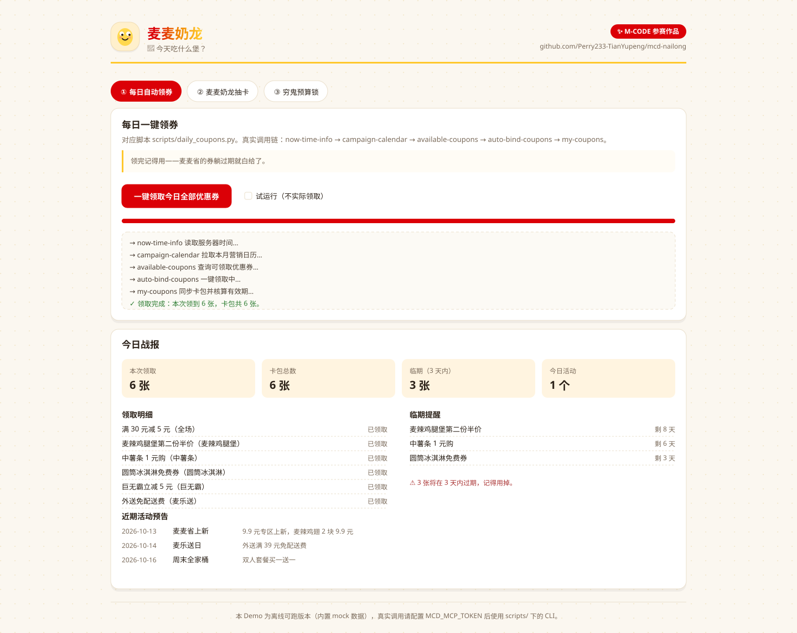
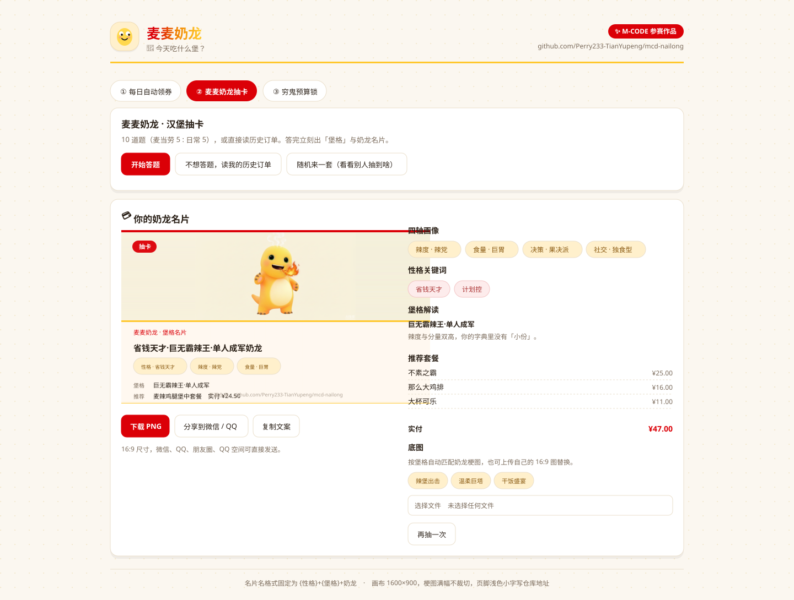
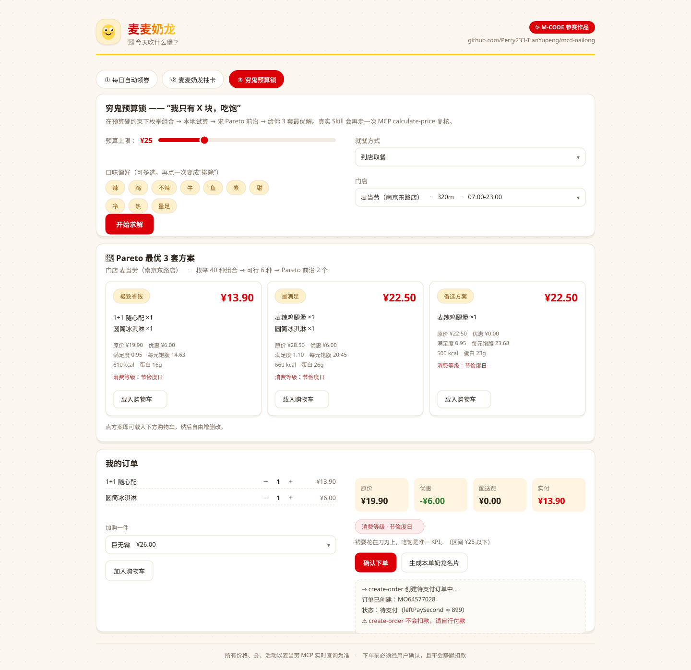
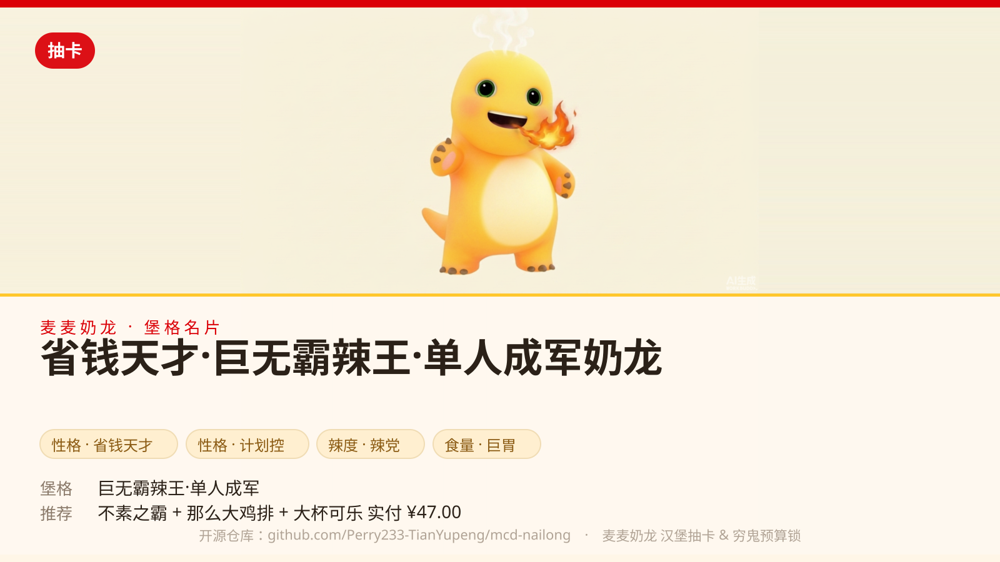

# 麦麦奶龙 🍔 · 麦当劳中国 MCP 创意 Skill

> 2026 麦当劳程序员创意开发大赛（M-CODE）参赛作品 · WorkBuddy × 麦当劳中国 MCP

**一句话**：把麦当劳 MCP 的三个开放能力（点餐 / 领券 / 活动日历）重新组装成三件「每天真的会用」的小工具——
**每天自动把券领干净**、**用一次抽卡认识你自己的点餐人格**、**在预算红线内吃到最优解**。

---

## 界面预览

> 由 `tools/make_previews.py` 按 `demo/index.html` 的真实版式与真实数据生成。
> 想要**真实浏览器截图**，在本机跑 `python tools/make_screenshots.py`。

### ① 每日自动领取全部优惠券



### ② 麦麦奶龙 · 汉堡抽卡

答完 10 道题（或读历史订单），直接生成「堡格」与可转发的 16:9 奶龙名片。
名片底图会**按人格自动匹配**：辣党用辣图、巨胃用大餐图、节俭度日用省钱图。



### ③ 穷鬼预算锁



### ④ 生成的名片卡（1600×900，可直接发微信 / QQ）

这是 `scripts/card_gen.py` 的真实产物，自包含单文件 SVG，素材已内嵌：
底部浅色信息面板放名片名 / 堡格 / 推荐套餐，页脚是仓库地址。



<details>
<summary>展开看 10 张素材如何按语义映射（点击）</summary>

| 素材 | 尺寸 | 使用场景 |
|---|---|---|
| `nailong-01-burger.png` | 1600×900 | 兜底 / 通用 |
| `nailong-02-spicy.png` | 1600×900 | 巨无霸辣王、椒香小钢炮（辣党） |
| `nailong-03-gentle.png` | 1600×900 | 温柔巨塔、云朵轻食家（温柔党） |
| `nailong-04-feast.png` | 1600×900 | 巨胃 / 大餐 |
| `nailong-05-lightmeal.png` | 1600×900 | 轻食 |
| `nailong-06-thrifty.png` | 1600×900 | 消费等级「节俭度日」（< ¥25） |
| `nailong-07-freedom.png` | 1600×900 | 消费等级「吃堡自由」（¥25–40） |
| `nailong-08-hero.png` | 1600×900 | 消费等级「豪情在天」（> ¥40） |
| `nailong-09-coupon.png` | 1600×900 | 每日领券 |
| `nailong-10-number.png` | 1600×900 | 到号提醒 |

</details>

---

## 为什么做这个

麦当劳已经开放了完整的能力（菜单、门店、券、算价、下单、积分、活动日历），
但「能力齐全」不等于「用起来爽」。这个项目解决三个真实存在的小痛点：

| 痛点 | 现实 | 本项目的解法 |
|---|---|---|
| 券总是忘了领 / 领了忘了用 | 麦麦省的券有有效期，躺过期就白给 | 每日自动领券 + **3 天临期提醒** + 今日活动播报 |
| 点餐决策疲劳 | 「随便」是最难的 prompt | 10 道题（麦当劳 5 : 日常 5）或读历史订单 → 出「堡格」+ 推荐套餐 + **可转发的奶龙名片** |
| 预算和欲望打架 | 比价工具只告诉你哪个便宜 | **预算硬约束下的 Pareto 求解**，给你三套覆盖「省钱 / 性价比 / 最满足」的方案 |

第三件事是核心：它不是「比价」，是**约束求解**。
你给「25 元 + 想吃辣 + 到店」，它枚举组合、在 MCP 的 `calculate-price` 上逐一试算、
在「实付价 ↔ 满足度」平面上求 Pareto 前沿，从前沿里挑三个代表点——

- **极致省钱**：花最少的钱把肚子填上
- **性价比之王**：每块钱换到的满足感最高
- **最满足**：预算内的天花板，吃到扶墙走

然后你可以**自由改单、换门店、直接下单，并让它在餐品就绪时喊你**。

---

## 三大能力（对应脚本）

### ① 每日自动领取全部优惠券 · `scripts/daily_coupons.py`

```bash
python scripts/daily_coupons.py --dry-run      # 先看看有什么券
python scripts/daily_coupons.py                # 一键全领
```

```text
┌──────────────────────────────────────────────┐
│ 🍟 麦麦每日领券战报   2026-10-12              │
└──────────────────────────────────────────────┘

① 今日活动  (1 条)
   · 周一会员日 — 任意套餐立减 5 元，会员专享

② 本次领取  6 张
   ✓ 满 30 元减 5 元（全场）
   ✓ 麦辣鸡腿堡第二份半价（麦辣鸡腿堡）
   ✓ 中薯条 1 元购（中薯条）
   ✓ 圆筒冰淇淋免费券（圆筒冰淇淋）
   ✓ 巨无霸立减 5 元（巨无霸）
   ✓ 外送免配送费（麦乐送）

③ 我的卡包  共 6 张
   · 麦辣鸡腿堡第二份半价  剩 8 天
   · 中薯条 1 元购  剩 6 天

⚠️ 临期提醒  3 张将在 3 天内过期
```

当天只跑一次（幂等），重复执行会提示，避免无意义请求。
配合 WorkBuddy 自动化挂个每天早上 9:00 的定时任务，就是真正的「每日自动领券」。

### ② 麦麦奶龙 · 汉堡抽卡 · `scripts/quiz_engine.py` + `scripts/card_gen.py`

```bash
# 答题（10 题 = 麦当劳 5 : 日常 5）
python scripts/quiz_engine.py --answers 1A,2B,3A,4C,5B,6C,7A,8A,9A,10D --out out/quiz.json

# 不想答题：读历史订单反推
python scripts/quiz_engine.py --history --out out/quiz.json

# 生成名片
python scripts/card_gen.py --quiz-result out/quiz.json --out out/card-quiz.svg
```

四轴 → 16 型「堡格」：

| 辣度 × 食量 | 基础堡格 |
|---|---|
| 辣 + 巨胃 | 巨无霸辣王 |
| 辣 + 轻食 | 椒香小钢炮 |
| 温柔 + 巨胃 | 温柔巨塔 |
| 温柔 + 轻食 | 云朵轻食家 |

再叠上「决策 × 社交」修饰：单人成军 / 组队指挥官 / 午夜纠结体 / 选择困难队长。

**名片名格式固定**：`{性格}+{堡格}+奶龙`，例如
`省钱天才·巨无霸辣王·单人成军奶龙`

名片是 **1600×900（严格 16:9）** 的自包含 SVG：奶龙梗图满幅不裁切，底部浅色信息面板放
名片名 / 堡格 / 推荐套餐，**页脚用浅色小字写明开源仓库地址**。
配套的 `.html` 里点一下「下载 PNG」，微信、QQ、朋友圈、QQ 空间直接发。

> 没有素材也能跑——内置占位图会顶上。把自己的 16:9 奶龙梗图放进 `picture/` 即自动替换，
> 素材规范与 **AI 生图提示词（中英双语 + 负面提示词 + 10 个场景变体）** 见 `picture/README.md`。

### ③ 穷鬼预算锁 · `scripts/budget_solver.py` + `scripts/order_flow.py`

```bash
python scripts/budget_solver.py --budget 25 --taste "辣,鸡"
```

```text
🎯 穷鬼预算锁 · 预算 ¥25.00  |  门店 S001
口味：辣、鸡   就餐方式：到店取餐
枚举 40 种组合 → 试算 6 种可行 → Pareto 前沿 2 个
────────────────────────────────────────────────────

【方案 A｜极致省钱】  实付 ¥13.90
   · 1+1 随心配 ×1
   满足度 0.80  |  每元饱腹 17.38 元/点  |  450 kcal / 蛋白 13g
   名片等级：节俭度日　钱要花在刀刃上，吃饱是唯一 KPI。

【方案 B｜最满足】  实付 ¥22.50
   · 麦辣鸡腿堡 ×1
   满足度 0.95  |  每元饱腹 23.68 元/点  |  500 kcal / 蛋白 23g
   名片等级：节俭度日
```

改单 → 选店 → 下单 → 支付 → 到号提醒：

```bash
python scripts/budget_solver.py --items B004:1,S001:1,D001:1 --budget 40   # 复核自定义订单
python scripts/order_flow.py stores --keyword 南京东路                      # 选门店（同时缓存 beCode）
python scripts/order_flow.py create --store S001 --items B004:1,S001:1 --yes   # 生成待支付订单
python scripts/order_flow.py pay --order MO12345678 --open                  # 取支付链接
python scripts/order_flow.py watch --order MO12345678                       # 付款后蹲号
```

```text
██████████████████████████████████████
█  🍔 可以取餐了！取餐号：A206
█  订单号：MO64577028
██████████████████████████████████████
```

### 💳 支付是怎么走的（重要）

**`create-order` 不会扣款。** 它只生成一笔「待支付」订单，返回 `payH5Url` 与 `payId`：

| 问题 | 答案 |
|---|---|
| MCP 下单会直接扣钱吗 | **不会**。订单状态是「待支付」，等你自己付 |
| 那钱什么时候扣 | 你打开 `payH5Url` 并在官方页面**确认支付**时 |
| `payH5Url` 是什么 | 2026-04 起已改为**扫码支付页** `https://m.mcd.cn/mcp/scanToPay?orderId=...`，不再有网页收银台 |
| 不付会怎样 | 约 15 分钟内未支付，订单**自动取消**，不产生任何扣款 |
| 本工具会代付吗 | **不会**。它不接触你的支付凭据，也不托管资金 |

所以完整链路是：**算价 → 创建待支付订单 → 你自行付款 → 轮询到号**。
下单前必须显式确认（`--yes` 或交互确认），本项目永不静默下单。

下单后按实付金额生成**消费名片**，命名规则 `{消费等级}+{汉堡名}+奶龙`：

| 实付 | 消费等级 | 底图角色 |
|---|---|---|
| < ¥25 | 节俭度日 | `thrifty` |
| ¥25 – 40 | 吃堡自由 | `freedom` |
| > ¥40 | 豪情在天 | `hero` |

---

## 快速开始

### ⚠️ Token 放哪里？（重要）

**不填进任何文件，只放环境变量 `MCD_MCP_TOKEN`。**

- 仓库里**没有、也不应该有**存放 Token 的文件；`mcp-config.example.json` 里的
  `${MCD_MCP_TOKEN}` 是**占位符**，不要把它改成真实值（这个文件要提交到 GitHub）。
- `.env` 不可用：本项目脚本**不读 `.env`**，只读进程环境变量。
- 不要在 `scripts/*.py` 里硬编码 Token —— 违反安全红线，且会被审核判为缺陷。

```bash
# Windows：永久写入当前用户环境变量（之后必须【重开终端 / 重启 WorkBuddy】才生效）
setx MCD_MCP_TOKEN "你的Token"

# Windows：只在当前窗口临时生效（调试用）
set MCD_MCP_TOKEN=你的Token

# macOS / Linux
export MCD_MCP_TOKEN="你的Token"      # 建议写进 ~/.bashrc 或 ~/.zshrc
```

验证是否生效：

```bash
python scripts/mcd_mcp.py ping        # 连通则打印服务器时间
python scripts/mcd_mcp.py list        # 应列出真实工具清单
```

> 想临时跳过 Token，给任意脚本加 `--mock` 即可用内置假数据跑通全流程。

> 另一种方式：如果你是在 WorkBuddy 客户端里**直接挂麦当劳 MCP 连接器**（而不是跑本仓库的 CLI），
> 那配置写在 **`~/.workbuddy/mcp.json`**（Windows：`C:\Users\<你>\.workbuddy\mcp.json`）。
> 这是本机用户目录、不在仓库内，不会被提交；改完需要在连接器管理页点「信任」后生效。

### 跑起来

```bash
# 1. 拿 Token（手机号登录 → 控制台激活）
#    https://open.mcd.cn/mcp
setx MCD_MCP_TOKEN "你的Token"        # Windows
export MCD_MCP_TOKEN="你的Token"      # macOS / Linux

# 2. 零依赖，直接跑（只需 Python 3.8+）
python scripts/daily_coupons.py
python scripts/quiz_engine.py --interactive --out out/quiz.json
python scripts/card_gen.py --quiz-result out/quiz.json --out out/card.svg
python scripts/budget_solver.py --budget 25 --taste "辣"

# 3. 没有 Token？全部加 --mock，用内置假数据照样跑通
python scripts/daily_coupons.py --mock
python scripts/budget_solver.py --budget 25 --taste "辣,鸡" --mock

# 4. 玩可交互 Demo（离线，无需 Token）
#    直接用浏览器打开 demo/index.html
```

---

## 一键自检（推荐第一个跑的东西）

**不需要 Token**，一条命令验证全部 34 项：

```bash
python tests/selfcheck.py
```

它会把三条能力 + 下单闭环全部用内置假数据跑一遍，并顺带做打包结构自查
（清理 `__pycache__`、检查包内目录层级、校验 `SKILL.md` 必填字段、检查文件编码与 BOM）。

```text
[1] MCP 客户端            3/3
[2] 每日自动领券          4/4
[3] 麦麦奶龙抽卡          5/5
[4] 名片卡生成（1600x900）7/7
[5] 穷鬼预算锁（Pareto）  5/5
[6] 下单闭环与支付        6/6
[7] 打包结构自查          4/4
--------------------------------------------------------
自检结果：34/34 通过  ✅ 全部通过
```

退出码 0 = 全通过；有失败项会逐条列出并返回 1。

想验证**真实**链路（需要 Token）：

```bash
python scripts/mcd_mcp.py ping        # 连通性
python scripts/daily_coupons.py --dry-run
python scripts/order_flow.py stores   # 拿到真实 storeCode
```

---

## 可交互 Demo

`demo/index.html` —— 单文件、离线可跑，三条主流程全部可点：

- **① 每日领券**：带调用链日志与进度条，输出今日战报
- **② 汉堡抽卡**：10 题作答 → 四轴 → 堡格 → 性格 → 推荐套餐 → **canvas 实时生成 1600×900 名片**，
  按人格自动选底图（也可本地上传 / 从 `picture/` 素材里挑）、下载 PNG、一键分享到微信 / QQ
- **③ 穷鬼预算锁**：预算滑块 + 口味多选 + 就餐方式 → 真实跑一遍 Pareto 求解 → 方案卡 → 购物车增删改 → 下单（含**不扣款**提示）→ 到号提醒（含提示音）

Demo 里的求解器与 `scripts/budget_solver.py` **同构**，不是假动画。

```bash
# 跑一遍 Demo 冒烟测试（需要 Node + jsdom）
npm install jsdom
node tests/demo-smoke.cjs
```

覆盖：脚本无运行时错误、领券流程、抽卡产出与命名规则、8 组预算参数均满足「实付 ≤ 预算」且给满 3 套、消费等级边界值。

---

## 项目结构

```
├── SKILL.md                  # Skill 定义（唯一强制文件：触发词 / 步骤 / 输出格式 / 红线）
├── README.md  MCP_INTEGRATION.md  SUBMIT_CHECKLIST.md  workbuddy.md
├── mcp-config.example.json   # 脱敏配置（仅 ${MCD_MCP_TOKEN} 占位符）
├── scripts/                  # 能力本体
│   ├── mcd_mcp.py            #   MCP 客户端（Streamable HTTP + JSON-RPC，零依赖）
│   ├── mcd_schema.py         #   官方入参契约层（beCode / orderType / productCode…）
│   ├── mcd_naming.py         #   堡格表 / 性格词库 / 消费等级 / 名片命名
│   ├── mock_data.py          #   离线假数据（覆盖 14 个 tool）
│   ├── daily_coupons.py      #   ① 每日自动领券
│   ├── quiz_engine.py        #   ② 汉堡抽卡（+ quiz_data.json）
│   ├── card_gen.py           #   ② 名片卡生成（SVG + HTML，1600×900）
│   ├── budget_solver.py      #   ③ 穷鬼预算锁（Pareto 求解）
│   ├── order_flow.py         #   ③ 下单闭环 + 支付指引 + 到号提醒
│   └── fetch_pictures.py     #   素材导入 / 16:9 体检 / 生成 Demo 清单
├── picture/                  # 10 张 16:9 奶龙素材（命名即语义角色）
├── demo/index.html           # 可交互 Demo（离线可跑，三条主流程）
├── docs/                     # README 用的界面预览图（平铺，不能建子目录）
├── tools/                    # 开发/文档工具（非技能运行时）
│   ├── make_previews.py      #   生成矢量界面预览图
│   ├── make_screenshots.py   #   用本机 Chrome 生成真实截图
│   └── fix_bom.py            #   编码体检（去 BOM / 查乱码）
└── tests/
    ├── selfcheck.py          # 一键自检：34 项，无需 Token
    └── demo-smoke.cjs        # Demo 冒烟测试（jsdom）
```

> ⚠️ 平台**只支持两级目录**（`根/一级子目录/文件`），所以预览图平铺在 `docs/` 下，
> **不能**放 `docs/images/`；打包前还必须清掉 `__pycache__`。

---

## 技术要点

- **零第三方依赖**：MCP 客户端用标准库 `urllib` 手写 Streamable HTTP + JSON-RPC 2.0，
  同时兼容 `application/json` 与 `text/event-stream` 两种响应体
- **契约层隔离**：`mcd_schema.py` 把官方入参（`beCode` / `orderType` / `beType` /
  `productCode` / `quantity` / `takeWayCode`）与可能变化的远端字段统一收敛，上层脚本零改动
- **限流友好**：串行调用、结果复用、指数退避重试；候选复核上限 24 次，不做无意义重复查询
- **可解释的评分**：口味匹配 / 单位价格饱腹度 / 满足度 / 组合丰富度四项加权，权重写在代码里
- **候选池四方向取样**：高分 / 每 5 元价格档代表 / 最低预估实付 / 最高性价比——
  只按分数取 Top-N 会让便宜组合被高价套餐挤掉，Pareto 前沿退化成单点（实测踩过）
- **安全的写操作**：下单必须显式确认（`--yes` 或交互确认），永不静默下单、永不代付
- **跨框架**：只用官方工具名描述流程，可接入任何支持 MCP 的客户端

---

## 目标用户

- **麦门信徒**：想把自己对麦当劳的爱具象化成一张名片
- **学生党 / 打工人**：预算有限，需要「多少钱能吃到什么」的确定答案
- **薅券懒人**：知道有券，但懒得每天点开 App 翻
- **健身 / 控卡人群**：需要按热量和蛋白质反推吃什么
- **行政 / HR**：团餐拼单凑满减（可用 `--taste` 与预算跑多人方案）

---

## 常见问题

| 现象 | 处理 |
|---|---|
| `缺少 MCP Token` | 确认已 `setx MCD_MCP_TOKEN`，并**重开终端** |
| HTTP 401 / 403 | Token 无效或未激活，回 <https://open.mcd.cn/mcp> 重新激活 |
| HTTP 429 | 触发限流（600 次/分钟/token），客户端已内置指数退避重试 |
| 下单报参数缺失 | 检查 `beCode` / `orderType` / `beType` / `takeWayCode` 是否齐全 |
| 下单后一直「待支付」 | 正常 —— **必须你自己打开 `payH5Url` 付款**，本工具不代付 |
| 名片 PNG 导不出来 | 浏览器同源限制，改为长按保存或截图；或用 CLI 生成 |
| 中文变成乱码 | 用 PowerShell `Get-Content/Set-Content` 改文件会**不可逆损坏**，改用 Write 类工具 |

---

## 免责声明

- 本项目为 **2026 麦当劳程序员创意开发大赛参赛作品，非麦当劳官方产品**。
- 所有价格、优惠券、活动信息以麦当劳 MCP 实时查询结果为准，本项目不硬编码任何价格。
- `picture/` 目录内的「奶龙」相关素材由使用者自行确认来源与授权，本仓库不对素材版权负责。
- MCP Token 代表你的麦当劳会员身份，请勿分享给他人。
- 下单前必须经用户确认；本项目不代替用户付款，也不接触任何支付凭据。

## License

MIT
